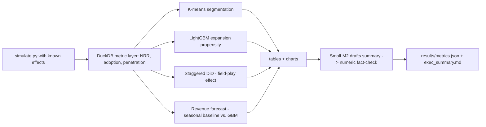

# B2B SaaS growth analytics

This project builds a **simulated** B2B SaaS panel and analyzes it the way a go-to-market data scientist would: a SQL metric layer (net revenue retention, feature adoption, seat penetration), account segmentation, an expansion-propensity model, a staggered difference-in-differences estimate of a field play, and a three-month revenue forecast. The simulator plants a known log-seat effect, so each estimator's error is measured against that truth. A local SmolLM2 model drafts the executive summary, and a regex fact-check rejects any draft number that is not in the computed tables. Every figure below is from the simulator, not from real customers.

## Setup

Python 3.11 or 3.12 on Windows. From this folder:

```text
python -m venv .venv
.venv\Scripts\pip install -r requirements.txt
```

The first line of `requirements.txt` pins the CPU PyTorch wheel (`--extra-index-url https://download.pytorch.org/whl/cpu`).

## How to run

```text
python run.py
python run.py --quick
python run.py --device cpu
```

`python run.py` regenerates the panel, refits every model, writes `results/`, and measures test coverage. `python run.py --quick` runs the same steps on 400 accounts so the smoke test can finish quickly. Optional `--device cuda` loads the summary model on a GPU when one is available. Weights are downloaded with `requests` into `data/models/` and checked against a SHA-256 pin. The simulated panel is written to `data/gtm.duckdb` and checked by row count.

Thread use is capped at 4 (`OMP_NUM_THREADS`, LightGBM `n_jobs`, and `torch.set_num_threads`).

## Architecture



## Design decisions

The seat path is

```text
log(seats_it) = alpha_i + 0.01 * t + seasonality + 0.08 * D_it + noise
```

`D_it` turns on at a staggered cohort month and stays on. About 40% of accounts are never treated. Cohort assignment does not depend on segment or usage, and the trend and seasonality are common across accounts. With a constant effect and no anticipation, account and month fixed effects recover the 0.08 log-point shift. Seats stay continuous seat-credits so integer rounding does not bias the log outcome. The 95% interval uses the larger of two cluster-robust standard errors (statsmodels and a one-regressor Liang-Zeger formula), clustered by account.

The naive baseline is the post-minus-pre mean of log seats on accounts that eventually receive the play. It absorbs the common time trend, so its error is the comparison the DiD is meant to fix.

Expansion propensity predicts a simulated "expansion-qualified" flag. The flag is a Bernoulli draw from an exclusive-or of lagged usage and lagged sales touches: high usage with few touches (product-led) or low usage with many touches (sales-assisted). A linear logistic model sees the same raw features and misses that interaction. The time split is written to `data/splits.json` before fitting. Train months are 1-17, validation months are 18-20, and test months are 21-23. Validation rows are scored for the artifact and are not used to fit or to choose hyperparameters. Hyperparameters are fixed in `config.yaml`.

The revenue forecast trains only on targets in months 20 and earlier. The three holdout months are predicted from features known at month 20. MAPE is the mean absolute percentage error of company-wide monthly revenue, which is the total a revenue plan would use. The seasonal-naive baseline copies revenue from twelve months earlier and misses the planted growth trend.

Segmentation is k-means (k=4) on standardized pre-holdout means of log seats, usage, penetration, and touches. The four segments are separated in the simulator so a silhouette above 0.25 is a check that the feature space still has structure, not a search over k.

The executive summary is drafted by SmolLM2-360M-Instruct. The fact-checker extracts numbers with a regex and keeps a draft only when every number matches `results/computed_tables.json` at the displayed precision. A draft that fails is reduced to sentences that pass. If none do, the run publishes the table-backed summary and records the rejection in `results/summary_drafts.json`.

## Limitations

The panel has no logo churn, so NRR is expansion and contraction only. Parallel trends are built into the generator, and the treatment effect is a single permanent log-seat shift rather than a mix of short-run and long-run effects. The expansion label is a designed commercial rule, not a latent outcome read out of the invoices. SmolLM2 is a small CPU model and often needs the fact-check gate. None of these results describe a real company.

## Data, model, and license

The account, usage, touch, and invoice tables are generated by `src/simulate.py` under the assumptions in `config.yaml`. The project code is released under the MIT license. SmolLM2-360M-Instruct weights are Apache 2.0, from `HuggingFaceTB/SmolLM2-360M-Instruct`. The weight file `model.safetensors` is checked against SHA-256 `e6bffe7435d7ddc10fd3b9a9efd429dafbacb1cb17015fb5562664e7532bf86e`.

## Evaluation artifacts

An independent check can ignore the prose and recompute the headline metrics from these files. `account_id` (and `month`, on panel files) maps each row back to the simulated panel.

| File | Recompute |
|---|---|
| `results/did_panel.csv` | Two-way fixed effects of `log_seats` on `treated`, with account and month effects. Relative error is `abs(estimate - 0.08) / 0.08`. The 95% interval is `estimate ± 1.96 * clustered SE`. |
| `results/propensity_predictions.csv` | AUROC of `p_lgbm` and `p_logistic` on rows with `split == test`. |
| `results/forecast_monthly.csv` | MAPE = mean of `abs(y_true - y_pred_gbm) / y_true` over the three holdout months. The same formula on `y_pred_seasonal_naive` is the baseline. |
| `results/forecast_account_month.csv` | Account-level forecast rows. Monthly totals match `forecast_monthly.csv`. |
| `results/segmentation_scaled.csv` | `silhouette_score` on the `z_*` columns using the saved `cluster` labels. |
| `results/computed_tables.json` | Allow-list for the numeric fact-check of `results/exec_summary.md`. |
| `results/monthly_nrr.csv`, `results/adoption.csv`, `results/nrr_12.csv` | SQL metric layer defined in `src/sql/metrics.sql`. |

Charts: `results/nrr_monthly.png`, `results/segments.png`, `results/propensity_roc.png`, `results/did_trends.png`, `results/forecast.png`.

The DiD criterion passes only when the relative error is at most 15% and the 95% interval covers 0.08. The AUROC criterion also requires LightGBM to beat the logistic baseline by at least 0.02. The MAPE criterion also requires the gradient-boosted forecast to beat the seasonal naive forecast. Coverage is the `pytest --cov` percentage for `src/`.

## Results

These rows are written by `python run.py` from `results/metrics.json`.

<!-- RESULTS_START -->

Run `python run.py` to fill this table from `results/metrics.json`.

<!-- RESULTS_END -->

## Tests

```text
python -m pytest
```

The smoke test is marked `smoke` and runs `python run.py --quick`.
