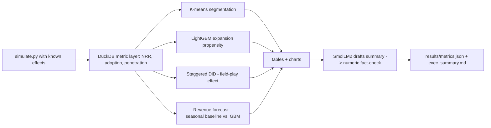

# B2B SaaS Growth Analytics - Account Segmentation, Expansion Propensity, and Field-Play Impact

`b2b-gtm-analytics` · new project · estimated build effort: 4 h

## Problem

B2B go-to-market teams ask which accounts to prioritize, what drives seat expansion, and whether a field program worked. Public B2B usage data barely exists, so this project writes a documented simulator of accounts, seats, product usage, sales touches, and revenue with known ground-truth effects. It then analyzes the simulated data the way a GTM data scientist would: SQL metric layer (NRR, adoption, penetration), customer segmentation, an expansion-propensity model, a difference-in-differences estimate of a staggered field play, and a revenue forecast. Because ground truth is known, every estimator's error is measured. A local small language model drafts the executive summary, and an automated check rejects any number in the draft that isn't in the computed tables.

## Target jobs and skills

- **OpenAI — Data Scientist, B2B Generalist** (`e2e900b8e5a8`): covers 93% of the JD's weighted top skills (SQL, Python, Product Analytics, Statistics, Data Visualization, Clustering, Causal Inference, LLMs, Time Series)

Skills/tools this project demonstrates: Python, SQL, Product Analytics, Statistics, Clustering, Classification, Gradient Boosting, Causal Inference, Time Series, Data Visualization, LLMs, Simulation

## Data

- **Dataset:** Simulated B2B SaaS dataset (generator included in the repo) — n/a (generated locally by src/simulate.py)
- **License/terms:** MIT (own code); SmolLM2-360M-Instruct weights are Apache 2.0
- **Size used:** 5,000 accounts x 24 months of usage, seats, touches, and invoices (~2M rows in DuckDB)
- **Plan:** Documented generative assumptions (segment mix, adoption curves, a +8% expansion effect from a staggered field play, seasonality). The README labels all results as simulated.

## Architecture

## Tech stack

Python 3.11, DuckDB, pandas, scikit-learn, LightGBM, statsmodels, matplotlib, transformers (CPU), pytest

## Deliverables

- Simulator with a config file and tests of its invariants
- SQL metric layer with documented definitions
- Segmentation, propensity, DiD, and forecast analyses with charts
- Executive summary drafted by a local LLM and gated by a numeric fact-checker

## Success criteria (all must hold on a from-scratch `python run.py`)

| Metric | Threshold | How it is measured |
|---|---|---|
| Field-play effect estimate (DiD) vs. simulated truth | within 15% relative error, 95% CI covering the truth | staggered DiD |
| Expansion propensity AUROC on held-out months | >= 0.75 and >= logistic baseline + 0.02 | time split |
| 3-month revenue forecast MAPE | <= 8% and lower than seasonal-naive | last 3 months held out |
| Segmentation silhouette score | >= 0.25 | standardized features |
| Numbers in the LLM summary that match computed tables | 100% (summary rejected otherwise) | regex fact-check |
| Test coverage of src/ | >= 70% | pytest --cov |

## Baseline

Naive before/after comparison for the field play; logistic regression for propensity; seasonal-naive forecast.

## Constraints

- Runs on Windows with `python run.py` from a fresh virtualenv; no make, shell scripts, paid APIs, or accounts.
- CPU-only by default (an optional `--device cuda` flag is fine); peak RAM <= 3 GB; total downloads <= 1.5 GB.
- PyTorch (if used) pinned to the CPU wheel via `--extra-index-url https://download.pytorch.org/whl/cpu`.
- Fixed random seeds; every reported number is written by code to results/metrics.json (never typed by hand).
- Test split is created once, saved, and never used for training, tuning, or threshold selection.
- Data download is scripted (Python requests), cached under data/, and verified by checksum or row count.
- The README states clearly that the data is simulated; resume bullets say "simulated".

## Draft resume bullets (placeholders are filled only with reproduced metrics)

- Built a simulated B2B SaaS dataset (5,000 accounts, 24 months) with a SQL metric layer for NRR, adoption, and seat penetration
- Estimated a staggered field program's effect on seat expansion with difference-in-differences ([DID_ERR] error vs. the simulated truth), where a naive before/after comparison was off by [NAIVE_ERR]
- Scored expansion propensity with LightGBM ([AUC] AUROC) and drafted executive summaries with a local LLM gated by an automated numeric fact-check
